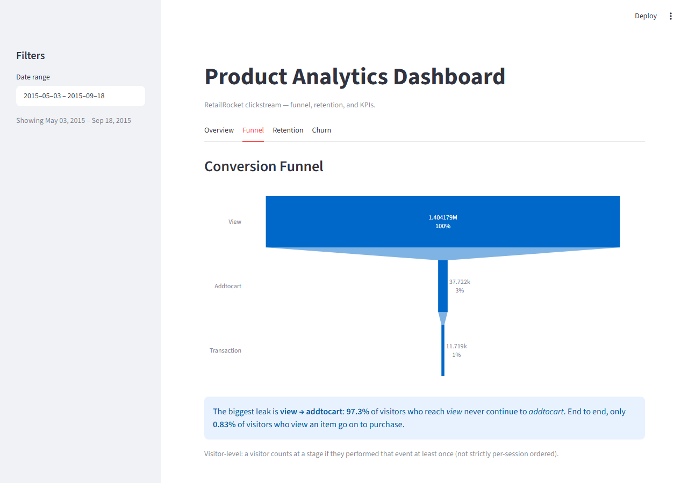
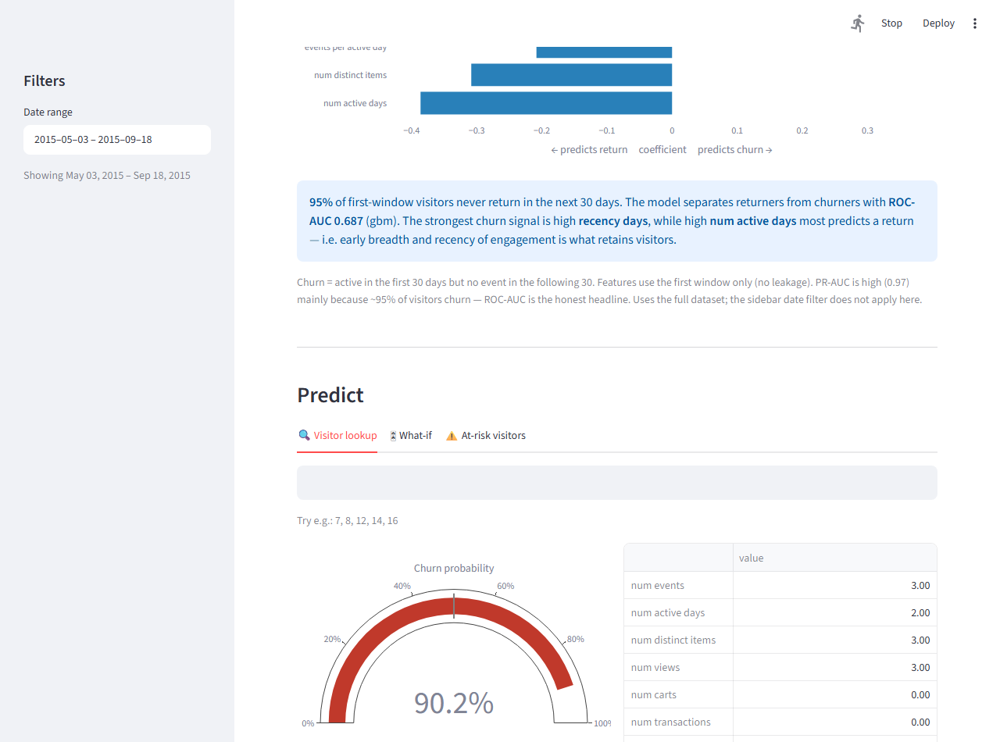

# Product Analytics Dashboard

Turns a real e-commerce clickstream (2.7M events) into product metrics —
conversion funnels, cohort retention, KPIs, and a churn model — where every
section surfaces a **plain-English insight**, not just a chart.

The funnel / cohort / KPI logic is written as pure, UI-free functions, so the
same analytics engine generalizes to any event stream (e.g. a fintech app),
not just this dataset.

**▶ Live demo: [p-analytics-dashboard.streamlit.app](https://p-analytics-dashboard.streamlit.app/)**

[](https://p-analytics-dashboard.streamlit.app/)
[](https://github.com/Ayush05G/product-analytics-dashboard/actions/workflows/tests.yml)

> The live app loads ~2.7M real events on a free-tier instance, so the first
> visit may take a moment to wake and load. If it's asleep, click "Yes, get
> this app back up!" and give it a few seconds.



## Dataset

[RetailRocket](https://www.kaggle.com/datasets/retailrocket/ecommerce-dataset)
`events.csv` — real clickstream data: `timestamp, visitorid, event, itemid,
transactionid`, where `event ∈ {view, addtocart, transaction}`.

| | |
|---|---|
| Events (after dedup) | **2,755,641** (460 exact duplicates dropped) |
| Unique visitors | **1,407,580** |
| Event mix | view 96.7% · addtocart 2.5% · transaction 0.8% |
| Date range | 2015-05-03 → 2015-09-18 (~4.5 months) |

The raw file is **large and git-ignored** — it is never committed. See
[Running locally](#running-locally) and [Deployment](#deployment) for how to
supply it.

## What's inside

| Tab | Question it answers | Sample insight (from the data) |
|---|---|---|
| **Overview** | How healthy is the funnel overall? | Acquisition is broad (~297k MAU) but only **0.83%** of visitors ever purchase and **10.2%** return on a second day — repeat engagement is the lever. Includes a daily-active-visitors trend chart. |
| **Funnel** | Where do visitors drop off? | Biggest leak is **view → addtocart** (only 2.69% convert); of those who add to cart, **31%** go on to purchase. |
| **Retention** | Do cohorts come back? | On average only **~4.6%** of a week's new visitors return the following week — heatmap plus an average decay curve. |
| **Items** | Which products drive the business? | The volume leader took **133 purchases** from 2,538 views, while the best-converting high-traffic item turns **31%** of views into purchases. |
| **Churn** | Who won't come back, and why? | **95%** of first-window visitors don't return in 30 days; **recency** drives churn while **active days / breadth** drive return (ROC-AUC ≈ 0.69). |

### Interactive churn predictor

The Churn tab doesn't just report the model — it lets you use it:

- **Visitor lookup** — enter any visitor ID from the observation window and get
  their churn probability as a gauge, with their behavioral features alongside.
- **What-if sliders** — describe a hypothetical first month of behavior and
  watch the predicted risk respond live (more active days ⇒ lower risk; going
  quiet ⇒ higher).
- **At-risk list** — visitors who added to cart or purchased but are predicted
  not to return, ranked by risk, exportable as CSV: the concrete re-engagement
  target list.



## Metric definitions

- **Funnel** (visitor-level): a visitor "reaches" a stage if they performed
  that event at least once. `funnel()` reports the step two ways:
  `step_conversion` = stage / previous stage, and `step_conversion_progressed`
  = visitors who reached this stage *and* the previous one / previous stage.
  Overall = transaction / view.
  > **Why two rates for cart→purchase.** 9.8% of buyers have no add-to-cart
  > event (tracking gap, or a path that skips the cart), so `stage / previous
  > stage` counts them in the numerator without ever having them in the
  > denominator — it reads 31.07% where progression-based (buyers who *also*
  > carted ÷ cart-adders) reads 28.04%. Fine for a stage-count view, but use the
  > progression figure as an experiment baseline: it's the rate a change to that
  > step can actually move. The Funnel tab shows the progression rate per step
  > and flags the gap. The same applies to view→addtocart, where 8.8% of
  > cart-adders have no recorded view (2.69% vs 2.45%).
  > See `results/funnel_numbers.md`.
- **Cohort retention** (weekly): a visitor's cohort is the ISO week of their
  first event; they are *retained* in week _N_ if they have **any** event that
  week. Week 0 is 100% by construction.
- **KPIs**: average **DAU/WAU/MAU** (mean distinct active visitors per
  day/week/month), **conversion rate** (visitors with ≥1 transaction / all
  visitors), and **repeat-visitor rate** (visitors active on ≥2 distinct
  calendar days / all visitors).
- **Churn** (return-prediction): observation window = first 30 days; a visitor
  active in it is labeled `churned = 1` if they have **no** event in the
  following 30 days. All features come from the observation window only (no
  leakage). A balanced logistic-regression baseline and gradient-boosted trees
  are compared on held-out ROC-AUC / PR-AUC; standardized logistic coefficients
  drive the interpretable insight.

## Project structure

```
app.py              Streamlit UI only — imports from src/
src/
  data_load.py      load + clean + validate events; resolves data source
  metrics.py        pure functions: funnel(), cohort_retention(), kpis(),
                    daily_active(), top_items()
  churn.py          churn dataset, model training/evaluation, scoring
scripts/
  funnel_analysis.py  funnel + segment cuts backing the growth case study
case-study.md       growth case study (funnel diagnosis + experiment design)
docs/
  case-study-brief.md  the brief that case-study.md was written against
results/
  funnel_numbers.md   computed figures the case study cites
tests/              pytest suite (synthetic fixtures, hand-computed expectations)
.github/workflows/  CI — pytest on every push
data/               raw data (git-ignored, never committed)
requirements.txt    pinned dependencies
```

> **Note:** `case-study.md` and `docs/case-study-brief.md` must not be renamed to
> names differing only by capitalisation (e.g. `CASE-STUDY.md`) — this repo is
> developed on a case-insensitive filesystem, where those collide into one file.

Metric logic stays separate from the UI and is verifiable on its own — each
`src/` module has a `__main__` that prints the numbers with internal
consistency checks:

```bash
python src/data_load.py   # sanity check: row count, visitors, event mix, dates
python src/metrics.py     # funnel / retention / KPI / item numbers + assertions
python src/churn.py       # churn model metrics, scoring + insight
pytest                    # unit tests (no dataset needed — synthetic fixtures)

python scripts/funnel_analysis.py   # funnel + segment cuts -> results/funnel_numbers.md
```

## Growth case study

[`case-study.md`](case-study.md) is a companion PM/growth artifact: the dashboard
*surfaces* the funnel drop-off, the case study *diagnoses it and designs
experiments to fix it*. Every figure in it is computed by
`scripts/funnel_analysis.py` — none are illustrative.

Headline: **2.69%** of viewers add to cart, **28.04%** of cart-adders buy
(**0.83%** end to end). The worst-converting pocket is **new visitors with
single-item carts at 23.86%** — which is also 65% of all cart activity.

Two results in there ran against the initial hypotheses, and the document keeps
the contradiction rather than smoothing it: multi-item carts convert *better*
(36.93% vs 25.76%), which undercuts the "cost shock on big baskets" story; and a
5% relative MDE would need ~17 weeks at the observed traffic, so the experiment
is re-specified at +10% / ~4.5 weeks with the resulting blind spot stated.

## Running locally

Requires Python 3.11+.

```bash
python -m venv .venv
# Windows:        .venv\Scripts\activate
# macOS / Linux:  source .venv/bin/activate
pip install -r requirements.txt
```

Place the RetailRocket `events.csv` in `data/` (download it from Kaggle), then:

```bash
streamlit run app.py
```

## Deployment

Live on **Streamlit Community Cloud** at
**[p-analytics-dashboard.streamlit.app](https://p-analytics-dashboard.streamlit.app/)**.

Because `data/` is git-ignored, the app fetches `events.csv` at runtime when
it isn't present locally. To reproduce the deploy:

1. Push this repo to GitHub.
2. Host `events.csv` at a direct-download URL. This project ships it as a
   gzipped [GitHub Release asset](https://github.com/Ayush05G/product-analytics-dashboard/releases/tag/data-v1)
   (`events.csv.gz`, ~33 MB vs. 90 MB raw); the loader decompresses `.gz`
   automatically.
3. In the Streamlit app's **Settings → Secrets**, add:
   ```toml
   EVENTS_URL = "https://github.com/Ayush05G/product-analytics-dashboard/releases/download/data-v1/events.csv.gz"
   ```
   (See [`.streamlit/secrets.toml.example`](.streamlit/secrets.toml.example).)
4. Deploy. The first boot downloads the file into the ephemeral `data/`;
   `@st.cache_data` keeps it warm afterward.

Resolution order is: local `data/events.csv` → `EVENTS_URL` → an actionable
error.

## Tech stack

Python · pandas · Plotly · Streamlit · scikit-learn. Exact versions are pinned
in [`requirements.txt`](requirements.txt).
